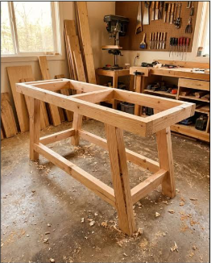
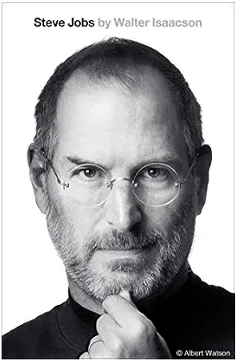
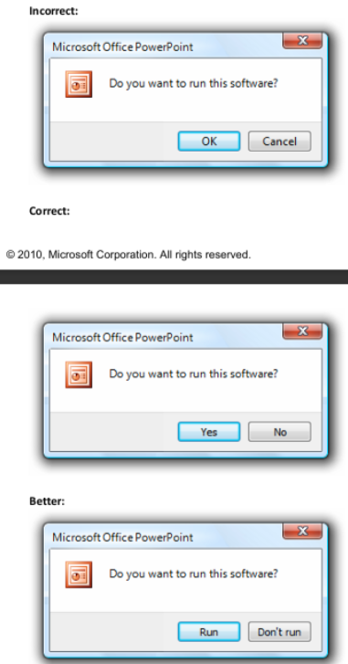

# Fluent UI - user experience, design language, and functional programming

## Woodworking

My father was a gifted craftsman, part of a generation of people who could do everything from building a house to tinkering with electronics. From a young age, he inspired me with his high-quality woodworking. My father taught me that craftsmanship becomes valuable through attention to detail. I remember opening a book about woodworking and finding that the first chapter was about keeping the workbench clean and tools sharp.

Later, I found this wisdom echoed in the childhood experiences described in Walter Isaacson's biography of [Steve Jobs](https://www.goodreads.com/book/show/11084145-steve-jobs). 

Jobs's love of aesthetics began with a lesson he learned in childhood, when his father explained why, when crafting a wooden wardrobe, it was important to polish even the hidden surfaces that people would not see. Polishing hidden parts is not about the fear that somebody will discover an unfinished surface, but a spiritual practice that becomes part of your identity: knowing that everything was done properly and that you can be proud of it no matter what.

## Desktop

My experience with serious, production UI development began when I was leading development at [Calxa](https://www.calxa.com/). Windows desktop apps had to look shiny, with Vista glass effects whose gradient calculations were extremely computationally expensive. It was a time when even cash flow and budget forecasting software had to look like a piece of art or an expensive luxury car with multiple layers of paint. I remember when my wife and I were young, lying in bed, selecting WPF pixel shader effects for GPU-accelerated animated transitions between financial data screens. As crazy as that may sound, it was a time when presenting financial results as animated car speedometers was considered impressive. We built our desktop software with Windows Presentation Foundation (WPF), using the [Model-View-ViewModel (MVVM)](https://learn.microsoft.com/en-us/dotnet/architecture/maui/mvvm) pattern.

Over a decade ago, I was enthusiastically studying the [User Experience Interaction Guidelines (Windows 7, Vista)](./assets/windows_user_experience_interaction_guidelines_windows_7_vista.pdf) to get Windows Logo certification for the software we were developing. I remember creating short memos for those who didn't have the patience to read 900 pages of guidelines. This deepened my understanding: the UI enthusiasts around me and I started to see not just a way to impress customers, but a methodical system grounded in deep expertise. Windows, layout, text, controls, links, tooltips, progress bars, prompts, notifications, keyboard and mouse interactions, dialog boxes, wizards, error and warning messages, icons, help - these things have been modernized, but design language and user experience patterns still serve the same goal. 
Many concepts from "User Experience Interaction Guidelines" are still relevant:

 
I remember once having dinner with a guy who was a big fan of the MacBook, and he mentioned that Apple also has [Human Interface Guidelines for macOS](https://developer.apple.com/design/human-interface-guidelines/designing-for-macos). Here, for example, is the [menu bar](https://developer.apple.com/design/human-interface-guidelines/the-menu-bar), demonstrating the excellence of Jobs's legacy on the iPad.

 
 
As the years passed, Windows Phone and Windows 8 introduced [Metro UI](https://en.wikipedia.org/wiki/Metro_(design_language)), which moved from Windows Vista's elaborate chrome to the opposite extreme: "content before chrome".
During Windows 8 Surface presentation, Steven Sinofsky [Windows 8 gadget was broken during presentation](https://www.youtube.com/watch?v=4QRWa68MtLc). My team bought one of first Windows 8 ThinkPad devices with 2GB of RAM that was impossible to use that was incredibly contrasting with incredibly smooth iPad with gradient UI components with 500 MB of RAM.
 

 
The Windows Phone content hub was a creative approach, but it simply wasn't as ergonomic as the iPhone or Android.
 

## Web

My journey into serious web development began in 2014, during the boom in JavaScript libraries and frameworks built on HTML5 and CSS3. When I [started thinking about redesigning our desktop software for the web](../../2017/2017-01-01-calxa-desktop-to-web/), we were choosing between Angular and React.

I pushed my team to use React because it felt leaner and more focused. At the time, I strongly believed in SOLID's Single Responsibility Principle, and React's focus on the UI appealed to me.

React also has roots in functional programming. Its creator, Jordan Walke, wrote an early prototype in OCaml, a language with a strong functional programming tradition, before porting it to JavaScript. In 2016, he created [ReasonML](https://en.wikipedia.org/wiki/Reason_(programming_language)), which gives OCaml a JavaScript-like syntax.

Elm took a different path: it is a purely functional language for building web frontends, not a React library. Its Model-View-Update pattern, known as The Elm Architecture, helped inspire Redux, a widely used state management library in the React ecosystem. After years of using MVVM with WPF and the [Universal Windows Platform](../../2017/2017-06-04-windows-application-block/), separating state and presentation already felt natural to me.

Today, I'm working on the transformation of Microsoft's largest CI/CD pipelines service. It supports 100,000 pipelines, runs 100,000 builds and 20,000 releases per day, and uses more than 800,000 VMs and container agents daily, serving 50,000 developers at Microsoft.

By 2026, I'm the main F# developer in Azure Release services, where I've authored hundreds of thousands of lines of F#. F# is a .NET language with roots in OCaml. That's amaizing how expertise and design principles may be connected cross different domains.

 
// TODO: finish the article