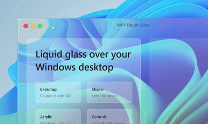
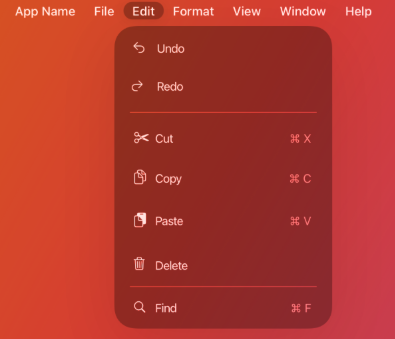
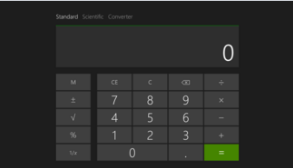
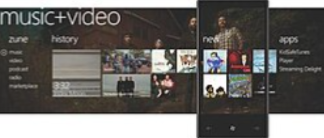

# Fluent UI - user experience, design language and functional programming

My father was man with golden hands, generation of people who could do everthing from buld a house to being electronics enhusiast. From young age he was inspiring me doing high quality wood works. My father was teaching me that craft becomes valuable when to apply attension to details. I remember when opened a book about woodworks and the first chapter was about how to keep table clean and instruments sharp. 

Later this wisdom resonates with [Steve Jobs](https://www.goodreads.com/book/show/11084145-steve-jobs) childhood experience written by Walter Isaacson. Jobs love to estetics begins from leason that he learned in childhood when his father was explaining him that when crafting wooden waredrobe why it is important to polish hidden side of details that people will not see. Polishing hidden parts if is not a fear or somebody will find not polished parts but spiritual practice that is part of your identity making you knowning that everything was done properly and you may be proud of it no matter what.

Serious undustrial UI development when I was leading development in [Calxa](https://www.calxa.com/). Windows Desktop apps had to look shiny Vista glass efects that were extreamly computationally heavy while calculating gradients. It was time when even Cashflow and Budget Forecasting software had to look like piece of art or expensive luxury car with multiple layers of painting. I remember when we with my wife were young laying in bad, selecting WPF pixel shader effects to visualize graphical card accelerated animated transitions between financial data screens - if that could sound crazy, that was time when it was representable to draw financial results as spidometers animated as car 

Over decade ago, I was enthusiastically learning [Windows User Experience Itenraction Guildelines (Windows 7, Vista)](./assets/windows_user_experience_interaction_guidelines_windows_7_vista.pdf)
 to get Windows Logo certification for software that we were developing. I remember when we were creating short memos for those who didn't have patience to read 900 pages of guidelines. This was real upgrade of my understanding when I and UI enthusiasts who were surounding me started see not just method to impress customer, methodologycal system with deep expertise. 
 
 I remember when once I had dinner with guy who was big fun of Macbook and he mentioned that Apple also has [Human Interface Guidelines for MacBook](https://developer.apple.com/design/human-interface-guidelines/designing-for-macos). Here is for example [menu bar](https://developer.apple.com/design/human-interface-guidelines/the-menu-bar) demonstratic excelence of Jobs heritage in iPad

 
 
 
 Year were going, Windows Phone and Windows 8 introduced [Metro UI](https://en.wikipedia.org/wiki/Metro_(design_language)) that from radical Windows Vista chrome switched to another extreamisting "content before chrome".
 Windows 8 calculator was looking like child sketch made by 30 minutes of student colledge lab work before-AI era.
 
 .
 
 Windows Phone content Hub was creative but approach but was not simply ergonomic as iPhone or Android.
 
 

Windows, layout, text, controls, links, tooltips, progress bars, prompts, notifications, keyboard and mouse, dialog boxes, wizards, error and warnings messages, icons, help - things were modernized but Design Language and User Experience patterns are still serving the same goal. This

// TODO: finish the article