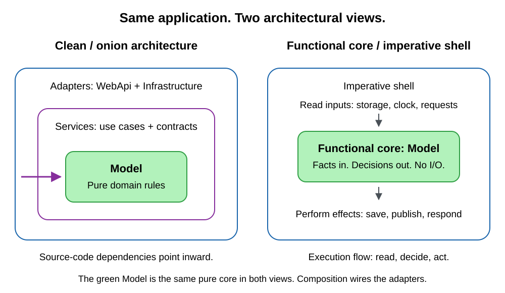

# Clean architecture, onion architecture, and a functional core: reuse the rules

In [my service extraction article](../2026-09-25-service-extraction-equipment/index.md), clean boundaries helped me extract a 10,000+ line microservice from a 100,000-line monolith. The instructions below carry those architectural rules into other F# projects, without carrying the application with them.

**Clean/onion architecture:** business rules belong at the center; dependencies point inward. Robert C. Martin's [The Clean Architecture](https://blog.cleancoder.com/uncle-bob/2012/08/13/the-clean-architecture.html) explicitly draws on Onion Architecture and other closely related approaches.

**Functional core, imperative shell:** pure functions make decisions; the shell reads inputs and performs effects.



*Left: dependencies. Right: execution flow. [Editable source](./architecture-views.excalidraw).*

## The original AI instructions

All 109 lines of [clean_architecutre_fsharp.md](./clean_architecutre_fsharp.md), verbatim:

````markdown
# Clean architecture for F# projects
This is the canonical, owner-authored architectural policy for F# projects that
adopt clean/onion architecture with a functional core.
## Layers and dependency direction
`A -> B` means A may depend on B, not the reverse.
| Layer | Responsibility | Allowed project-layer dependencies |
|---|---|---|
| Model | Pure domain types and business rules | Model only |
| Services | Use cases and interfaces for external capabilities | Model and Services |
| Infrastructure | Data access and external capability implementations | Model, Services and Infrastructure |
| WebApi | HTTP handlers and background-service adapters | Model, Services and WebApi |
| Composition root | Bind implementations, configure hosting and map routes | All layers |
Services owns the interfaces implemented by Infrastructure. WebApi calls those
interfaces, not Infrastructure implementations. The composition root (for example
`Composition.fs` and `Program.fs`) may reference concrete implementations to wire
dependency injection, hosting and observability; it must not contain business rules.
Host-registration code that needs concrete implementations belongs at this boundary.
F# compile order must support these dependencies, but does not grant permission to
cross architectural boundaries. In particular, compiling Infrastructure before
WebApi does not permit handlers to use Infrastructure directly.
### Model
1. Keep domain logic pure and deterministic, and domain types structurally
   testable. Do not perform I/O or hide side effects.
2. Keep dependency injection, infrastructure concerns and external SDK types out
   of this layer.
3. Prefer algebraic data types (ADTs): records, discriminated unions and tuples.
   Use `Result` for expected domain failures rather than exceptions.
4. Model records may contain function-valued fields when the structure is a pure
   description or capability passed between layers. Model must not create or
   execute side effects through those functions; Services or Infrastructure
   constructs and invokes effectful capabilities. This allowance does not replace
   interface-based service contracts with records-of-functions.
5. Keep Model coverage close to 90% or higher, including practical edge and
   defensive paths.
### Services
1. Move logic that can readily be expressed as a pure function into Model.
2. Compose services using .NET constructor injection. Inject interfaces rather
   than concrete service or infrastructure implementations; introduce a service
   interface when needed to provide a testable contract.
3. Follow SOLID: one responsibility per service, extension through abstractions
   rather than unrelated changes, substitutable implementations, small focused
   interfaces and dependency inversion. Prefer interfaces over abstract classes
   and avoid implementation inheritance.
4. Keep services stateless and effects explicit through injected capabilities.
5. Do not directly use database, messaging, storage or other external SDKs.
   Implement SDK-dependent behavior in Infrastructure behind Services interfaces.
6. Use domain ADTs in service APIs and interface inputs and outputs. Do not pass
   database DAOs, messaging DTOs or HTTP request/response DTOs through these
   contracts, even when their names use the general `Data` suffix.
7. Keep Services coverage around 80%, including practical edge and defensive paths.
### Infrastructure
1. Implement the interfaces declared in Services. Isolate external SDKs and
   infrastructure concerns here.
2. Move business rules into Services, or into Model when they can be expressed
   as pure functions without infrastructure concerns.
3. Use data access objects (DAOs) for database persistence shapes, with `Dao` or
   the general `Data` suffix; do not call persistence shapes DTOs. Within
   Infrastructure, use data transfer objects (DTOs) only for messaging shapes,
   with `Dto` or `Data` suffixes. For example, map `CommandMessage` to
   `CommandMessageDao` for persistence or `CommandMessageDto` for a message queue.
4. Map between domain types and persistence DAOs or messaging DTOs using pure
   functions in Infrastructure. Cover those mappings with focused unit tests.
   HTTP request/response DTO mappings belong in WebApi, not Infrastructure.
5. Test our own SDK-using code, not the SDKs or external services themselves.
   Project-specific integration tests may exercise our adapters against real
   dependencies.
6. Mark infrastructure classes `[<ExcludeFromCodeCoverage>]` to avoid measuring
   SDK and external-service plumbing as domain coverage. This does not remove
   the requirement to test our mappings and adapter behavior.
### WebApi
1. Keep HTTP handlers and ASP.NET `BackgroundService` adapters here. Keep them
   stateless and effects explicit.
2. Handle transport concerns such as authorization, request guards and result
   mapping; delegate business rules and use cases to Services or Model.
3. Use abstractions declared in Services and implemented in Infrastructure.
   Do not call infrastructure SDKs or instantiate concrete adapters in handlers
   or background services.
4. HTTP request and response shapes are data transfer objects (DTOs) owned by
   WebApi. Use descriptive `Request`, `Response` or `Dto` names; the general
   `Data` suffix is also acceptable. Keep these transport contracts separate
   from domain types and do not pass them through Services APIs.
5. Map between HTTP request/response DTOs and domain types using pure functions
   in WebApi. Cover those mappings with focused unit tests; keep business
   validation and rules in Model or Services.
## F# module and compile ordering
Keep dependencies acyclic: a module may use only modules compiled before it.
Keep each folder and nested subgroup contiguous in `*.fsproj`; do not scatter
one group between files from another group. Order groups by their dependencies
and apply the same rule recursively.
Correct grouping:
```xml
<Compile Include="Group1\Module1.fs" />
<Compile Include="Group1\Module2.fs" />
<Compile Include="Group1\SubGroup1\Module3.fs" />
<Compile Include="Group1\SubGroup1\Module4.fs" />
<Compile Include="Group1\SubGroup2\Module5.fs" />
<Compile Include="Group1\SubGroup2\Module6.fs" />
<Compile Include="Group2\Module7.fs" />
```
Incorrect grouping:
```xml
<Compile Include="Group1\Module1.fs" />
<Compile Include="Group1\SubGroup1\Module3.fs" />
<Compile Include="Group2\Module7.fs" />
<Compile Include="Group1\SubGroup2\Module5.fs" />
<Compile Include="Group1\SubGroup1\Module4.fs" />
```
Here `Group2` splits `Group1`, and `SubGroup2` splits `SubGroup1`. An otherwise
valid compile dependency does not make either interleaving acceptable.
````

## Reuse across projects

Copy the file into each adopting repository and reference it from contributor or AI instructions. Then ask:

> Read the architecture policy. Implement equipment reservation: pure decisions in Model, storage contracts in Services, adapters in Infrastructure, and HTTP mappings in WebApi. Add focused tests, build, and run them.

For billing, replace reservation rules with charge calculations and storage adapters with account/payment adapters. The domain changes; the boundaries stay. Keep project-specific exceptions explicit and update copies deliberately.

The same instruction file can guide an AI assistant across F# projects, keeping architectural expectations explicit from the start.